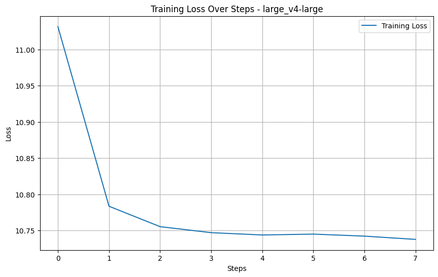
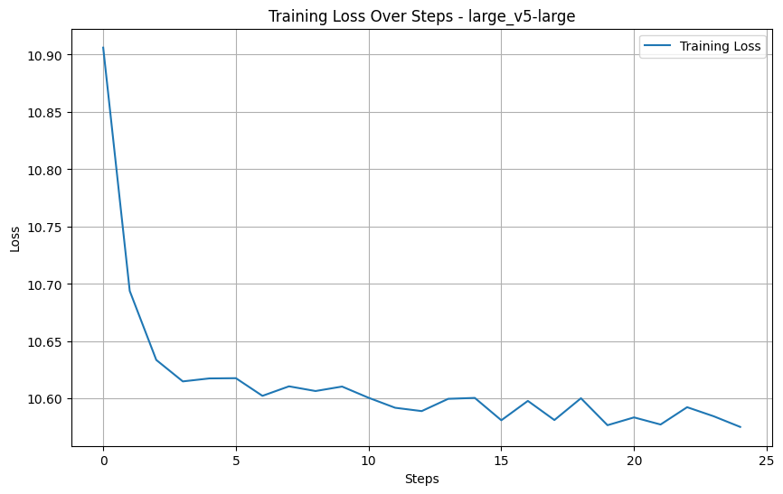
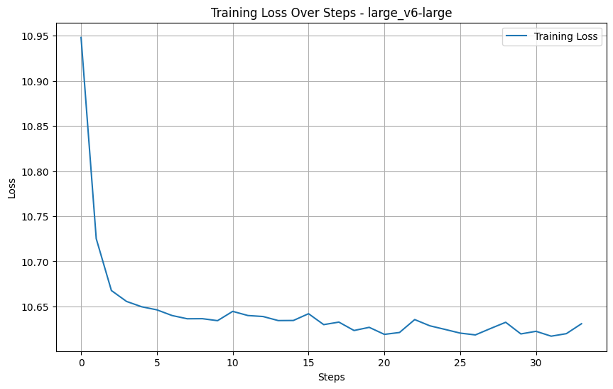
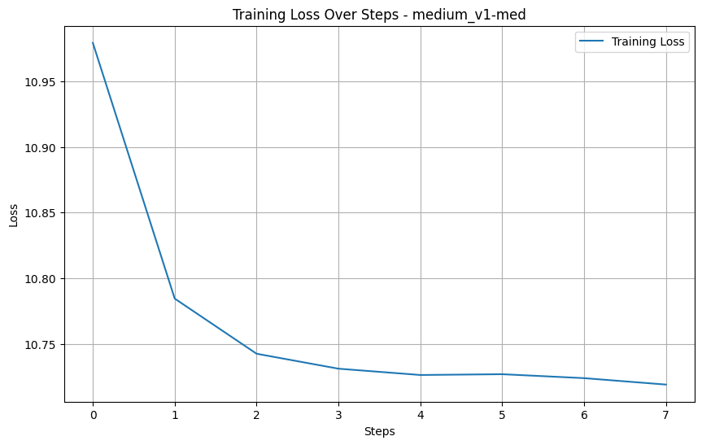
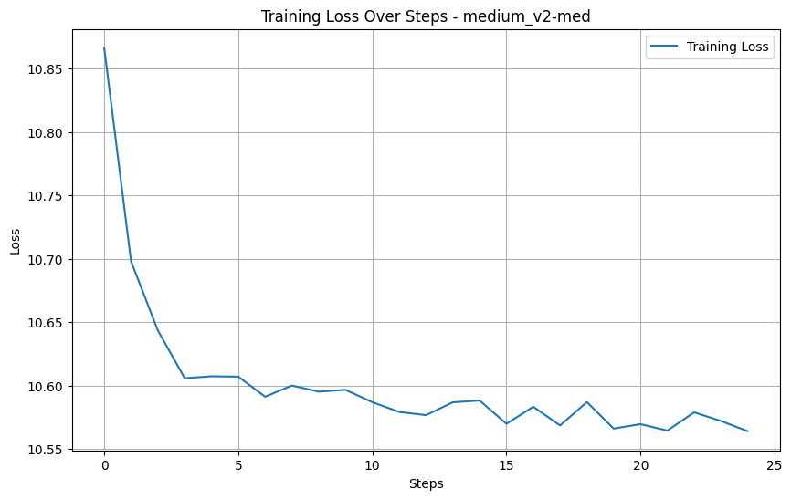
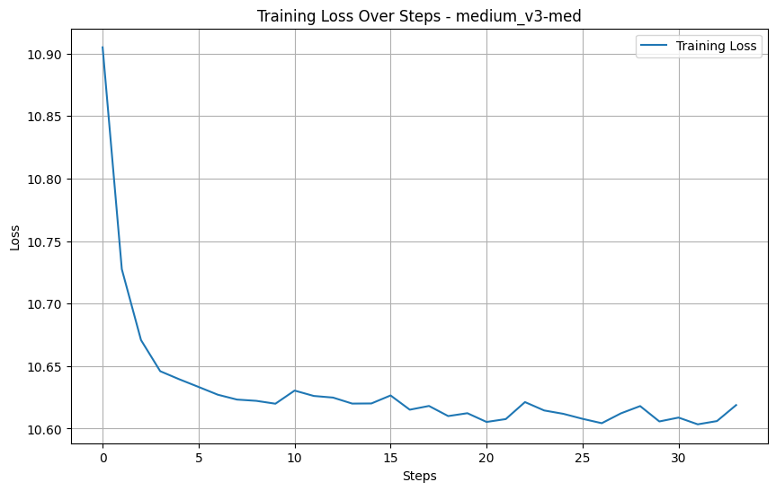

# Turkish GPT-2 LoRA Fine-Tuning

This repository contains a notebook experiment that adapts Turkish GPT-2 models to question answering and instruction responses. The notebook uses `ytu-ce-cosmos/turkish-gpt2-medium` or `ytu-ce-cosmos/turkish-gpt2-large` with LoRA. It runs one selected model and dataset at a time.

The checked-in loss plots and generated text are historical artifacts. They are not a benchmark, and the stored answers include factual errors. No trained weights or LoRA adapters are included in this repository.

## Data

The notebook reads the checked-in CSV files under `Data/`:

| Selection | File | Fields used |
| --- | --- | --- |
| `v1` | `Data/v1.csv` | `soru` and `insan cevabı`; the machine answer and preference columns are not training targets |
| `v2` | `Data/v2.csv` | `talimat`, optional ` giriş`, and ` çıktı`; leading whitespace in headers is normalized |
| `v3` | `Data/v3.csv` | Combined question-answer pairs in `soru` and `çıktı` |
| Qualitative tests | `Data/test.csv` | `soru` prompts and `çıktı` references |

These are general Turkish QA and instruction data, rather than a dedicated mathematics dataset. The repository does not establish independent human review, original dataset provenance, or an uncontaminated evaluation split.

Training uses one causal sequence per pair:

```text
Soru: {question} Cevap: {answer}<EOS>
```

The selected model's tokenizer encodes both question and answer in the same sequence. Labels match the input tokens and padding labels are `-100`. EOS remains a training target even though EOS is also used as padding. The loss covers the whole sequence. Text is truncated to 511 tokens plus EOS by default; long examples can lose answer text.

## Run

Use Python 3.11 to 3.13 and an isolated environment. From the repository root:

```bash
python -m venv .venv
```

Activate it with `.venv\Scripts\Activate.ps1` in PowerShell or `source .venv/bin/activate` on Linux/macOS, then install and register a notebook kernel:

```bash
python -m pip install --upgrade pip
python -m pip install -r requirements.txt
python -m ipykernel install --user --name turkish-gpt2 --display-name "Turkish GPT-2"
```

Open `code/code.ipynb` in a Jupyter-compatible editor and choose that kernel. Start the kernel from the repository root or `code/` so the notebook can find `Data/` and its helper module.

Set the first configuration cell:

- `MODEL_SIZE`: `medium` or `large`.
- `DATASET_VERSION`: `v1`, `v2`, or `v3`.
- `MODEL_REVISION`: defaults to a pinned Hub commit for the selected size. Use a different full 40-character commit only when you intend to change the base weights.
- `RUN_TRAINING`: set to `True` when you intend to download weights and train. It defaults to `False`.

Run through the generation cell. The notebook loads only the selected base model, uses a seed of 42, a batch size of one with four gradient accumulation steps, and gradient checkpointing. FP16 is enabled only with CUDA. Medium and large training still require substantial memory and compute; CPU fallback is supported by the configuration but does not make these experiments inexpensive. Install a suitable PyTorch CUDA build if you intend to use a GPU.

The run writes checkpoints to `results/`, training logs to the console, an adapter and tokenizer to `saved_models/{model_size}_{dataset_version}/`, and a loss plot to the repository root. `run_metadata.json` records the resolved base model commit, selected dataset and its SHA-256 hash, seed, sequence length, and installed training package versions. Keep the data files fixed and use the recorded model revision when repeating a run; seeded execution does not guarantee identical results across hardware.

Generation uses the trained adapter and the same `Soru: ... Cevap:` prompt format. Long prompts are trimmed from the left to reserve space for new tokens and retain the answer delimiter. It displays the first five test prompts with reference answers. It does not calculate accuracy or validation loss. Increase the slice explicitly if you want all qualitative prompts.

To load a saved adapter later, restart the kernel, run the configuration cell, and run the final adapter-loading cell. An adapter requires the corresponding base model weights; it is not a standalone complete model.

## Offline checks

These checks use the bundled CSVs, a tiny local tokenizer, and a randomly initialized GPT-2 with one small layer. They do not download pretrained weights or measure Turkish answer quality:

```bash
python -m unittest discover -s tests -v
```

The tests cover CSV schema differences, causal label alignment, EOS and padding handling, tokenizer selection, truncation, the training opt-in guard, and one tiny CPU LoRA training step followed by saving, reloading, and generation.

## Repository contents

- `code/code.ipynb`: model selection, preprocessing, LoRA training, saving, plotting, and inference.
- `code/qa_training.py`: data loading, shared causal preprocessing, and generation helpers.
- `Data/`: source CSVs.
- `tests/`: offline regression checks.
- `loss/`: historical experiment plots.
- `outputs/outputs.docx` and `outputs/outputs_cleaned.txt`: historical generated samples, including incorrect responses.

## Historical loss plots

The current notebook logs training loss only. Historical plots are retained as supplied; no new runs or quality metrics are represented here.

| Model | Version 1 | Version 2 | Version 3 |
| --- | --- | --- | --- |
| Medium |  |  |  |
| Large |  |  |  |

The repository license is in [LICENSE](LICENSE). Base models and external libraries retain their own licenses and terms.
